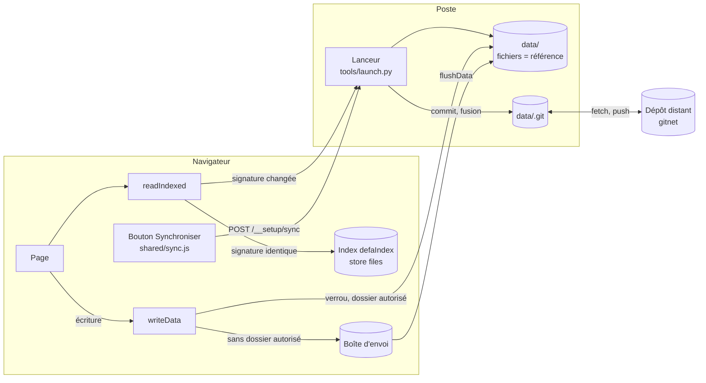

# Architecture de la synchronisation des données

Comment les données partagées de la suite (disponibilités, missions, affectations, CR, utilisateurs, configuration)
circulent entre les pages, le navigateur, le dossier `data/` et les autres postes. Décisions du 5 octobre 2026 ;
conception d'origine : [INDEX_DONNEES.md](INDEX_DONNEES.md) § 3 à § 9.

## 1. En bref

- **Les fichiers de `data/` font foi.** Tout le reste (index du navigateur, copies, boîte d'envoi) se reconstruit.
- **Lire vite** : le navigateur garde une copie de chaque fichier, signée de sa date (`updated_at`) ; il ne relit que
  les fichiers dont la date a changé.
- **Écrire sûr** : chaque écriture passe par un verrou ; sans dossier autorisé, elle attend dans le navigateur (boîte
  d'envoi).
- **Partager** : `data/` est un dépôt git à part (pas celui du code). Le bouton **« Synchroniser »** de l'en-tête
  commite les changements du poste au nom du trigramme connecté, récupère ceux des autres, fusionne, puis envoie.
- **Conflits** : résolus **fiche par fiche** par le lanceur ; rien n'est jamais perdu (la version écartée est gardée
  dans `_conflits/` et signalée).

## 2. Les acteurs

| Acteur | Où | Rôle |
|---|---|---|
| **Page** | navigateur | lit et écrit les données du pool par `MissionAssignments.readData` / `readIndexed` / `writeData` (`shared/assignments.js`) |
| **Index du navigateur** | IndexedDB, base `defaIndex` (`shared/data_index.js`) | registre des missions, CR, copies signées des fichiers du pool (store `files`) ; reconstruit à volonté |
| **Boîte d'envoi** | `localStorage` `suiteDataOutbox:v1` | écritures faites sans dossier autorisé ; relues en priorité tant qu'elles sont plus récentes ; écrites au prochain `flushData()` (au plus tard avant une synchronisation) |
| **Dossier `data/`** | disque (ici `E:\DEFA\data`, partagé par jonction entre les espaces de travail) | **la référence** : un fichier par fiche autant que possible |
| **Lanceur** | `tools/launch.py` (serveur local, port 8000 par défaut) | sert la suite et `data/`, refait les index du dossier à la demande, exécute la synchronisation (`tools/data_sync.py`) |
| **Dépôt git de `data/`** | `data/.git` | historique des données ; branche en cours (aujourd'hui `test`) |
| **Dépôt distant** | `gitnet` : `git@gitnet.fr:woyczek/defa-data.git` | point de rencontre des postes |



## 3. Ce qui est synchronisé

| Synchronisé (pool) | Pas synchronisé |
|---|---|
| `disponibilites/` (déclarations par pilote et par semaine, anciens fichiers) | `**/_index.json` : index régénérés par le lanceur et les pages |
| `utilisateurs/` (fiches, rôles, préférences de thèmes) | `**/_conflits/` : versions écartées lors d'une fusion (propres au poste) |
| `config/` (catégories de disponibilité, mode develop / production…) | `local/` : sauvegardes du navigateur, état de la dernière synchronisation (`local/sync.json`) |
| `missions/` (missions, affectations, suivi, journal) | `.defa_instance` : repère du lanceur |
| `cr/` (comptes rendus) | préférences d'affichage (thème, langue, blocs…) : propres à chaque navigateur |
| `atc/` (sessions ATC de la semaine) | réglages du planning ODV (`odvPlanning:v1`, voir la dette technique) |

## 4. Lire : copies signées

1. La page lit l'**index du dossier** (`disponibilites/_index.json`, `utilisateurs/_index.json`) : une requête. Le
   lanceur le refait à chaque demande ; il porte la date (`updated_at`) de chaque fichier.
2. Pour chaque fichier voulu, `readIndexed(fichier, date)` : copie de l'index du navigateur **de même date** → servie
   sans requête ; sinon le fichier est lu, et sa copie remplacée.
3. Pas de copie utilisée pour un fichier de la boîte d'envoi, une lecture « fraîche », ou sans date connue.

Effet mesuré (Planning ODV, 57 pilotes) : à la deuxième ouverture, 11 requêtes au lieu de 114, données à 1,6 s au lieu
de 7,2 s.

## 5. Écrire : verrou, puis annonce

1. `writeData(fichier, valeur)` : sous un verrou Web Locks par fichier (`defa:data:<chemin>`), écriture dans le
   **dossier autorisé** (Paramètres › Installation › Sources et dossiers) ; sinon dans la boîte d'envoi, avec une
   notification qui donne la raison.
2. La copie de l'index du navigateur est mise à jour, l'entrée de l'index du dossier aussi (date du fichier écrit).
3. Les autres onglets sont prévenus (BroadcastChannel `defa-data`) et relisent à la demande.

## 6. Synchroniser : un passage

```mermaid
sequenceDiagram
  participant U as Utilisateur
  participant S as sync.js (page)
  participant L as Lanceur (data_sync.py)
  participant G as data/.git
  participant R as Dépôt distant
  U->>S: clic « Synchroniser (n) »
  S->>S: flushData() : boîte d'envoi → dossier
  S->>L: POST /__setup/sync { author: trigramme }
  L->>G: git add (fichiers du pool modifiés) + commit, auteur = trigramme
  L->>R: git fetch
  L->>G: git merge (branche distante)
  alt conflit
    L->>G: fusion fiche par fiche (§ 7), commit de la fusion
  end
  L->>R: git push
  L-->>S: compte rendu (envoyés, reçus, conflits)
  S->>U: notifications ; pages relues (fichiers changés seuls)
```

- **Déclenchement : à la main.** Pas d'envoi automatique. Le bouton affiche `(n)` = modifications de ce poste +
  commits à envoyer + commits à recevoir (dépôt distant relu toutes les 5 minutes, page visible).
- **Fusion (merge), pas de rebase** : l'historique n'est jamais réécrit, une seule fusion à résoudre.
- **Un passage à la fois** par lanceur (verrou). Une fusion qui échoue au milieu est **annulée** : le dépôt n'est
  jamais laissé à moitié fusionné.
- **Branche sans branche distante** : le premier passage la crée (push `-u`).

## 7. Conflits : trois niveaux

| Niveau | Exemple | Réponse |
|---|---|---|
| Deux onglets du même navigateur | deux pages ouvertes écrivent le même fichier | verrou par fichier, relecture sous verrou, message aux autres onglets |
| Deux postes sur le même dossier | dossier partagé (Synology, OneDrive) | écriture sous verrou ; fusions propres à certains fichiers (registre des CR, index des dispos) |
| Deux copies réunies par git | deux pilotes qui synchronisent | **fusion fiche par fiche par le lanceur**, ci-dessous |

**Fusion fiche par fiche** (`tools/data_sync.py`, fonction `resolve`) :

| Fichier en conflit | Règle |
|---|---|
| Une fiche par fichier (semaine d'un pilote, utilisateur, mission, suivi, configuration…) | la plus récente (`updated_at`) l'emporte ; l'autre est gardée dans `<dossier>/_conflits/<nom>.<locale\|distante>.<date>` et signalée |
| `missions/affectations.json` | fusion à trois (ancêtre commun, ma version, la leur) par affectation (mission, pilote, rôle) ; modifiée des deux côtés : la plus récente |
| `missions/affectations_log.json` | journal en ajout seul : les deux côtés réunis, triés par date |
| Supprimé d'un côté, modifié de l'autre | la version modifiée est gardée |
| `cr/missions.yaml` (tous les CR) | comme une fiche : la plus récente l'emporte, l'autre dans `_conflits/` — **à fusionner à la main** (limite connue jusqu'au découpage par année, voir la dette technique) |

## 8. Identité et sécurité

- **Auteur des commits** : le trigramme de l'utilisateur connecté (utilisateur usurpé compris), adresse
  `<tri>@defa.local`. Sans trigramme, la synchronisation est refusée (notification).
- **Accès** : les routes `/__setup/sync-status` et `/__setup/sync` ne répondent qu'aux pages de cette machine (en-tête
  `Host` local, en-tête `X-DEFA-Setup`), comme les autres routes du lanceur.
- **Identifiants git** : ceux du système (clé SSH, gestionnaire d'identifiants) ; git ne pose jamais de question
  (`GIT_TERMINAL_PROMPT=0`) ; la suite ne stocke aucun identifiant.
- **Droits** : en transport git, chacun peut écrire tout le pool (les rôles sont vérifiés par les pages). La
  vérification par un serveur viendra avec le moteur central (voir la [feuille de route](ROADMAP.md)).

## 9. Plusieurs utilisateurs, en attendant le serveur central

- **Recevoir** : à chaque lancement, le lanceur fait un `git pull` de `data/` ; le bouton « Synchroniser » reçoit
  aussi ce qui est arrivé depuis (son compteur l'annonce, dépôt distant relu toutes les 5 minutes).
- **Envoyer** : le bouton « Synchroniser » commite les changements du poste, fusionne avec ceux des autres et pousse.
- **Ce qu'il faut à chaque poste qui envoie** : git installé, la suite ouverte par le lanceur, un **droit d'écriture
  sur le dépôt de données** (un compte par personne sur l'hébergeur git, ou un compte partagé), et une **clé SSH**
  (adresse `git@…`) ou des **identifiants HTTPS enregistrés dans git** (adresse `https://…`).
- **Préciser et vérifier le dépôt** : Premier lancement, étape 1, carte « Dépôt git de synchronisation des données » —
  adresse `git@hôte:compte/dépôt.git` ou `https://hôte/compte/dépôt.git`, « Vérifier » (le dépôt répond-il depuis ce
  poste ? `git ls-remote`, 30 s au plus, sans aucune question) et « Enregistrer » (dépôt distant de `data/` ; sans
  données encore, l'adresse sert à les récupérer). **Jamais bloquant** : un dépôt qui ne répond pas (accès refusé,
  introuvable, hôte injoignable) est signalé, la suite fonctionne, sans partage. Une branche absente du dépôt distant
  est créée par la première synchronisation.
- **Poste sans git ni droit d'écriture** : choisir comme dossier des données un **dossier partagé** (Synology,
  OneDrive…) que synchronise un poste qui a git (le Centre, par exemple) ; ses écritures arrivent dans ce dossier, le
  poste équipé les envoie au dépôt. C'est ce que le serveur central rendra inutile : un compte suffira
  ([ROADMAP.md](ROADMAP.md), étape 2).

## 10. Exploitation

| Situation | Que faire |
|---|---|
| **Première synchronisation** | le bouton compte tout ce qui n'a jamais été commité dans `data/` ; le premier clic l'envoie et crée la branche distante si besoin |
| **Notification de conflit** | ouvrir le fichier indiqué dans `_conflits/`, comparer avec le fichier gardé, reporter à la main ce qui manque, synchroniser ; supprimer la copie ensuite |
| « Une fusion ou un rebase est en cours dans data/ » | une opération git manuelle n'est pas finie : `git -C data merge --abort` (ou la terminer), puis recommencer |
| « Commit local seulement : pas de dépôt distant » | `data/` n'a pas de dépôt distant : rien n'est partagé |
| « Synchronisation interrompue : … » | message de git (réseau, accès au dépôt distant refusé…) ; rien n'a été perdu, recommencer plus tard |
| Lanceur injoignable | la synchronisation exige le lanceur (git ne tourne pas dans le navigateur) |
| Une page affiche une vieille donnée après un changement fait hors de la suite sans lanceur | Paramètres › Maintenance › Caches › Index des données : Purger |

**Essais sans risque** :

- `python tools/data_sync.py --essai` : dépôt distant et deux copies temporaires, modifications croisées, conflit,
  fusion, réception ; tout est vérifié puis effacé ;
- `python tools/launch.py --port 8774 --data <copie de data>` : sert une copie de `data/` (par exemple un clone d'un
  dépôt nu) pour essayer le bouton dans le navigateur sans toucher au vrai dépôt.

## 11. Évolution : le webservice

Le même pool pourra passer par un **moteur central** (webservice) au lieu de git, sans changer le format des fichiers :
`GET /v1/changes?since=`, `GET /v1/file/<chemin>` (avec `ETag`), `PUT` avec `If-Match` (412 → fusion fiche par fiche,
nouvel essai), comptes et rôles vérifiés par le serveur. Détail et calendrier : [ROADMAP.md](ROADMAP.md).

## 12. Fichiers

| Fichier | Contenu |
|---|---|
| `shared/sync.js` | bouton « Synchroniser » de l'en-tête, état, compte rendu en notifications |
| `tools/data_sync.py` | passage de synchronisation, fusion fiche par fiche, essai sur copies |
| `tools/launch.py` | routes `/__setup/sync-status`, `/__setup/sync` ; index du dossier refaits à la demande ; option `--data` |
| `shared/assignments.js` | `readData`, `readIndexed`, `writeData`, `flushData`, boîte d'envoi, verrous |
| `shared/data_index.js` | base `defaIndex` (missions, CR, copies signées) |
| `shared/dispos.js`, `shared/users.js` | lectures par signature des déclarations et des fiches ; index du dossier tenu à jour à l'écriture |
| `docs/INDEX_DONNEES.md` | conception d'ensemble (index, réplication, expiration, conflits, étapes) |
