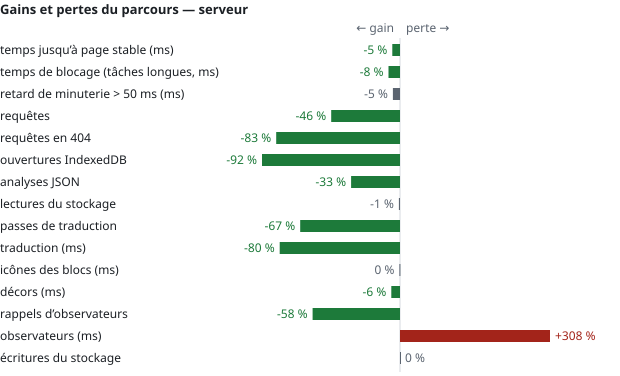
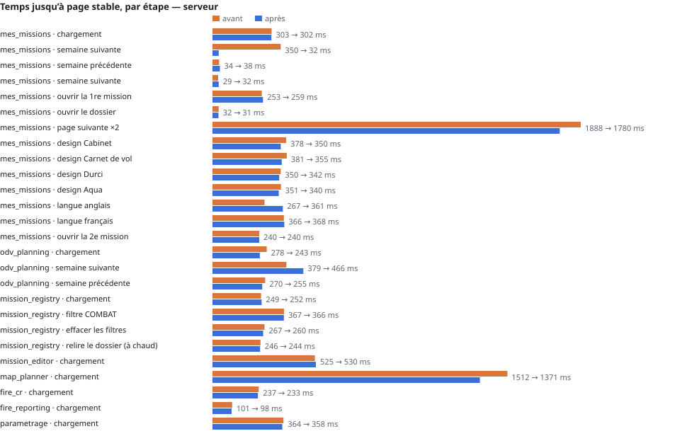
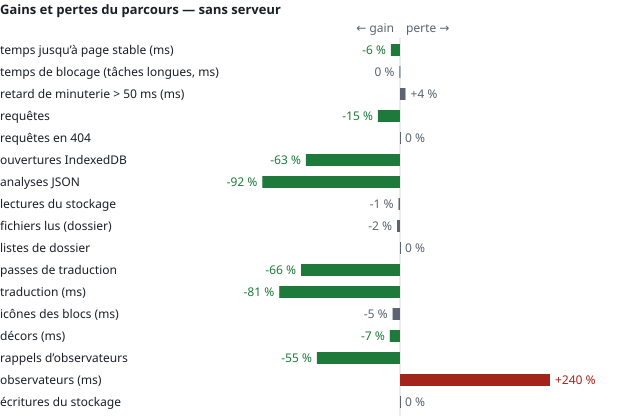
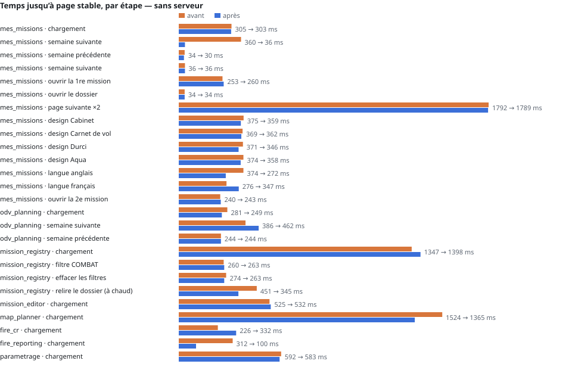
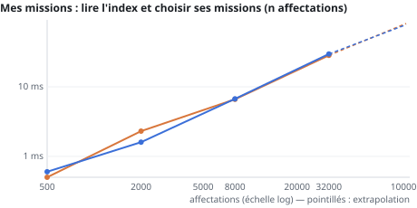
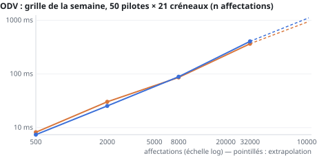
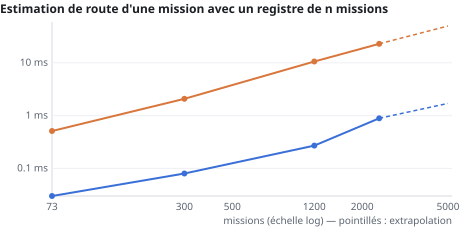
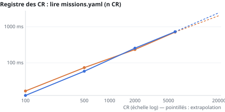
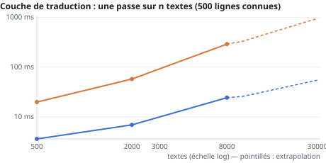

# Rapport de performance

Généré par `python tools/perf_report.py` d’après `docs/perf/runs/` (méthode et plan d’action :
[PLAN_PERF_2026-10-04.md](PLAN_PERF_2026-10-04.md)). Barres orange : avant ; bleues : après.

## Synthèse (4 octobre 2026, branche `feature/perf-audit`)

**Ce qui a été fait.** Les sept actions de priorité 1 du plan, plus deux corrections trouvées par l'audit « après » :
une lecture mémorisée qui relisait deux fois une clé absente (réglages de routage : 440 analyses JSON par ouverture du
registre) et une recherche de préfixes de traduction qui parcourait toutes les lignes connues pour chaque texte
inconnu (désormais rangées par premier mot).

**Comment c'est mesuré.** Même parcours de clics (Mes missions, ODV, registre, générateur, studio, CR, Paramètres),
avec serveur et sans serveur (dossiers simulés comme en `file://`). Avant et après **alternés** (avant, après, avant,
après…), trois passages chacun, **médiane par étape**, page visible, même sonde des deux côtés. Les écarts de temps
d'une même mesure d'un passage à l'autre atteignent ±30 % sur cette machine : seuls les compteurs (requêtes, analyses,
ouvertures…) sont exacts ; les temps se lisent en tendance.

**Gains du parcours** (totaux, serveur / sans serveur) :

| | avant | après |
|---|---:|---:|
| ouvertures IndexedDB | 213 / 51 | 17 / 19 (−92 % / −63 %) |
| analyses JSON | 690 / 5 296 | 465 / 435 (−33 % / −92 %) |
| requêtes | 146 / 129 | 79 / 110 (−46 % / −15 %) |
| requêtes en 404 | 86 / 9 | 15 / 9 (−83 %) |
| passes de traduction | 236 / 247 | 79 / 84 (−67 %) |
| temps de traduction | 709 / 727 ms | 140 / 141 ms (−80 %) |
| rappels d'observateurs | 1 365 / 1 831 | 570 / 817 (−58 %) |

**Ce qui n'a pas bougé.** Le temps de blocage (tâches longues) reste à ≈ 255 ms sur tout le parcours : il vient du
studio cartographique (≈ 300 ms au chargement, construction de la base SIA) et de Paramètres, pas touchés. Les
lectures du stockage (`getItem`) sont stables : elles restent, mais ne sont plus suivies d'une analyse JSON. Coût des
observateurs eux-mêmes : 1 → 5 ms sur tout le parcours (le traducteur unique note les nœuds modifiés), négligeable.

**Montée en charge.** Deux courbes changent de pente :

- estimation de route : 22,8 → 0,9 ms par estimation à 2 400 missions (× 25), et le registre n'est plus réanalysé à
  chaque estimation ;
- traduction : 290 → 24 ms par passe à 8 000 textes (× 12) ; extrapolé à 30 000 textes : 0,95 s → 55 ms.

Les autres sont **inchangées** (linéaires, non traitées) et donnent les prochains points de rupture :

| Cas | Aujourd'hui | À 20 000 | Seuil gênant |
|---|---|---|---|
| Registre des CR (un seul `missions.yaml`) | 13 ms (100 CR) | ≈ 2,5 s à chaque page de CR / reporting | ≈ 3 000 CR (0,5 s) |
| Grille de l'ODV (50 pilotes × 21 créneaux) | 7 ms (500 affectations) | ≈ 240 ms par semaine affichée | ≈ 40 000 affectations |
| Registre du navigateur (≈ 2,7 Ko par mission) | 219 Ko (73 missions) | — | **quota du stockage du navigateur** (5 à 10 Mo selon le navigateur ; le panneau de mesure en accepte davantage, le banc ne le voit donc pas) : atteint entre ≈ 1 900 et 3 800 missions, et l'écriture du registre échoue alors **sans message** |
| Index des affectations (Mes missions) | < 1 ms | 17 ms | pas avant 100 000 |

**Proposé ensuite** (priorité 2 du plan, à décider) : registre du navigateur allégé (≈ 0,5 Ko par mission au lieu de
3 Ko, détail lu dans les fichiers — repousse le quota au-delà de 10 000 missions — et un avertissement si
l'écriture échoue) ; registre des CR découpé par année avec un
index ; grille de l'ODV indexée par pilote et par jour ; signatures du dossier des missions écrites dans
`data/missions/` pour qu'un autre poste profite de la relecture incrémentale ; et, hors plan, la construction de la
base SIA du studio cartographique faite en tâche de fond (seul blocage notable restant).

## Parcours de clics — serveur

Avant : « avant » (4f0b0283, 3 passage(s)) — après : « après » (c683ddd5, 3 passage(s)). Plusieurs passages : médiane par étape.

| indicateur (total du parcours) | avant | après | écart |
|---|---:|---:|---:|
| temps jusqu’à page stable (ms) | 10017 | 9506 | -5 % |
| temps de blocage (tâches longues, ms) | 275 | 254 | -8 % |
| retard de minuterie > 50 ms (ms) | 641 | 611 | -5 % |
| requêtes | 146 | 79 | -46 % |
| requêtes en 404 | 86 | 15 | -83 % |
| ouvertures IndexedDB | 213 | 17 | -92 % |
| analyses JSON | 690 | 465 | -33 % |
| lectures du stockage | 918 | 911 | -1 % |
| passes de traduction | 236 | 79 | -67 % |
| traduction (ms) | 709 | 140 | -80 % |
| icônes des blocs (ms) | 197 | 196 | 0 % |
| décors (ms) | 187 | 176 | -6 % |
| rappels d’observateurs | 1365 | 570 | -58 % |
| observateurs (ms) | 1 | 5 | +308 % |
| écritures du stockage | 15 | 15 | 0 % |

« Temps jusqu’à page stable » inclut les délais voulus (animations, regroupements) : les compteurs ci-dessus mesurent
le travail réellement fait.

## Parcours de clics — sans serveur

Avant : « avant » (4f0b0283, 3 passage(s)) — après : « après » (c683ddd5, 3 passage(s)). Plusieurs passages : médiane par étape.

| indicateur (total du parcours) | avant | après | écart |
|---|---:|---:|---:|
| temps jusqu’à page stable (ms) | 11615 | 10911 | -6 % |
| temps de blocage (tâches longues, ms) | 258 | 257 | 0 % |
| retard de minuterie > 50 ms (ms) | 544 | 564 | +4 % |
| requêtes | 129 | 110 | -15 % |
| requêtes en 404 | 9 | 9 | 0 % |
| ouvertures IndexedDB | 51 | 19 | -63 % |
| analyses JSON | 5296 | 435 | -92 % |
| lectures du stockage | 1306 | 1293 | -1 % |
| fichiers lus (dossier) | 296 | 290 | -2 % |
| listes de dossier | 146 | 146 | 0 % |
| passes de traduction | 247 | 84 | -66 % |
| traduction (ms) | 727 | 141 | -81 % |
| icônes des blocs (ms) | 211 | 200 | -5 % |
| décors (ms) | 199 | 186 | -7 % |
| rappels d’observateurs | 1831 | 817 | -55 % |
| observateurs (ms) | 2 | 5 | +240 % |
| écritures du stockage | 19 | 19 | 0 % |

« Temps jusqu’à page stable » inclut les délais voulus (animations, regroupements) : les compteurs ci-dessus mesurent
le travail réellement fait.

## Montée en charge

Données fictives de taille croissante, vraies fonctions de la suite ; ajustement `t = a·n^b` et extrapolation.

| cas | b avant | b après | extrapolé avant | extrapolé après |
|---|---:|---:|---|---|
| Mes missions : lire l'index et choisir ses missions (n affectations) | 0.95 | 0.95 | 5000 → 4.7 ms, 20000 → 17.6 ms, 100000 → 81.3 ms | 5000 → 4.6 ms, 20000 → 17.1 ms, 100000 → 78.3 ms |
| ODV : grille de la semaine, 50 pilotes × 21 créneaux (n affectations) | 0.90 | 0.96 | 5000 → 64.6 ms, 20000 → 224.3 ms, 100000 → 950.6 ms | 5000 → 63.2 ms, 20000 → 238.4 ms, 100000 → 1113 ms |
| Registre dans le navigateur : écriture + lecture (n missions) | 1.03 | 1.03 | 500 → 3.9 ms, 2000 → 16.5 ms, 5000 → 42.6 ms | 500 → 3.9 ms, 2000 → 16.5 ms, 5000 → 42.4 ms |
| Estimation de route d'une mission avec un registre de n missions | 1.10 | 1.12 | 500 → 4 ms, 2000 → 18.2 ms, 5000 → 49.7 ms | 500 → 0.1 ms, 2000 → 0.6 ms, 5000 → 1.7 ms |
| Registre des CR : lire missions.yaml (n CR) | 0.91 | 1.00 | 1000 → 134.2 ms, 5000 → 579.1 ms, 20000 → 2040.3 ms | 1000 → 122.8 ms, 5000 → 614.7 ms, 20000 → 2460.5 ms |
| Couche de traduction : une passe sur n textes (500 lignes connues) | 0.97 | 0.69 | 3000 → 102.3 ms, 10000 → 328.3 ms, 30000 → 951 ms | 3000 → 11.2 ms, 10000 → 25.6 ms, 30000 → 54.6 ms |

Volumes mesurés :

- Registre dans le navigateur : écriture + lecture (n missions) (avant) : 73 → 219 Ko, 300 → 798 Ko, 1200 → 3195 Ko, 2400 → 6392 Ko
- Registre dans le navigateur : écriture + lecture (n missions) (après) : 73 → 219 Ko, 300 → 798 Ko, 1200 → 3195 Ko, 2400 → 6392 Ko
- Registre des CR : lire missions.yaml (n CR) (avant) : 100 → 332 Ko, 500 → 1661 Ko, 2000 → 6646 Ko, 6000 → 19939 Ko
- Registre des CR : lire missions.yaml (n CR) (après) : 100 → 332 Ko, 500 → 1661 Ko, 2000 → 6646 Ko, 6000 → 19939 Ko

