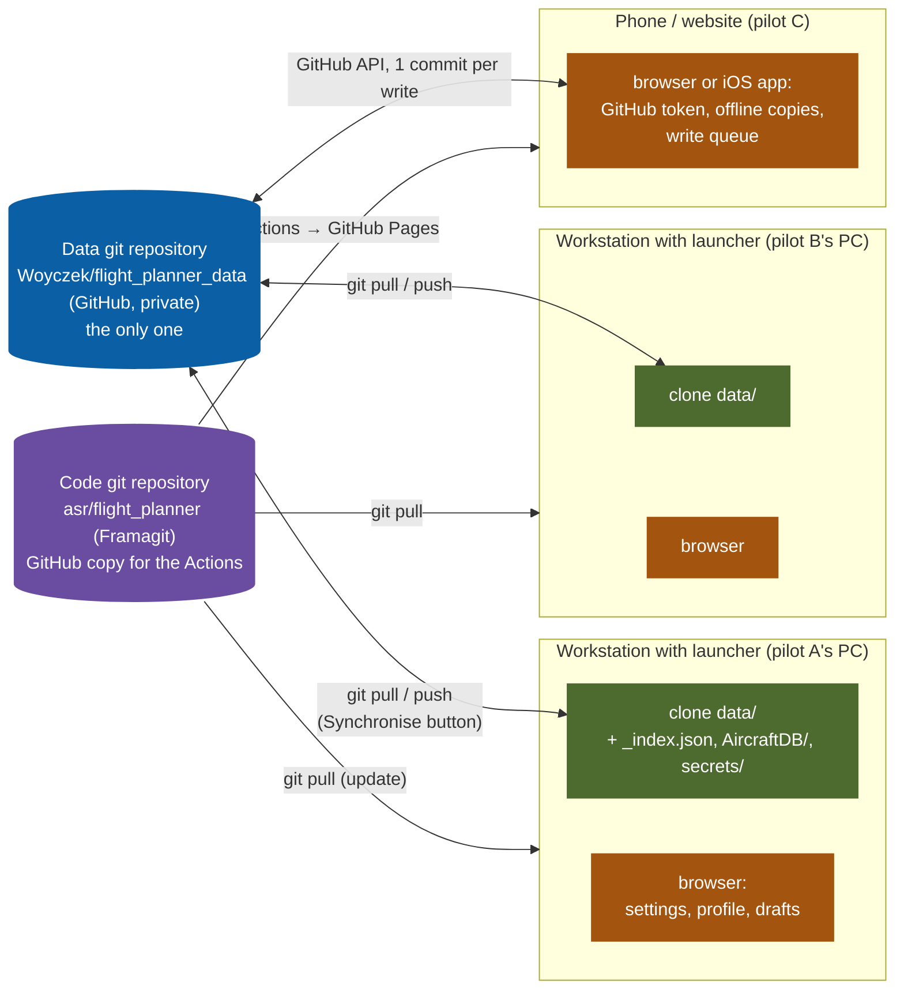
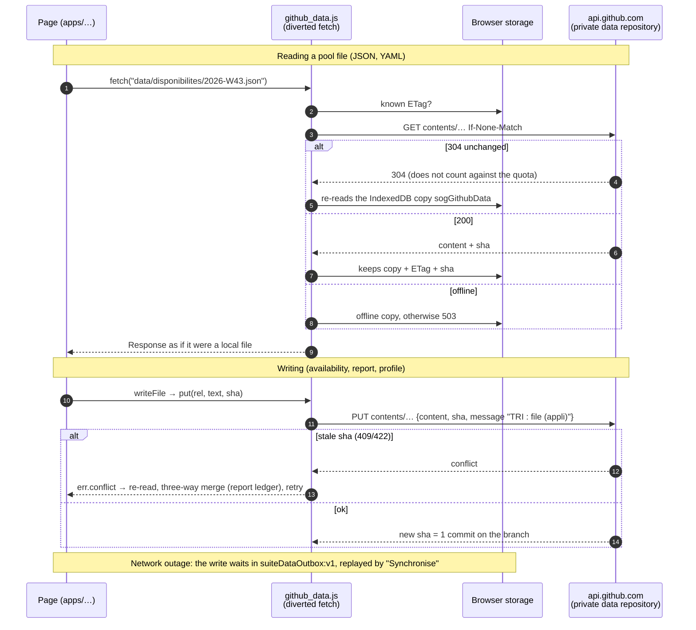
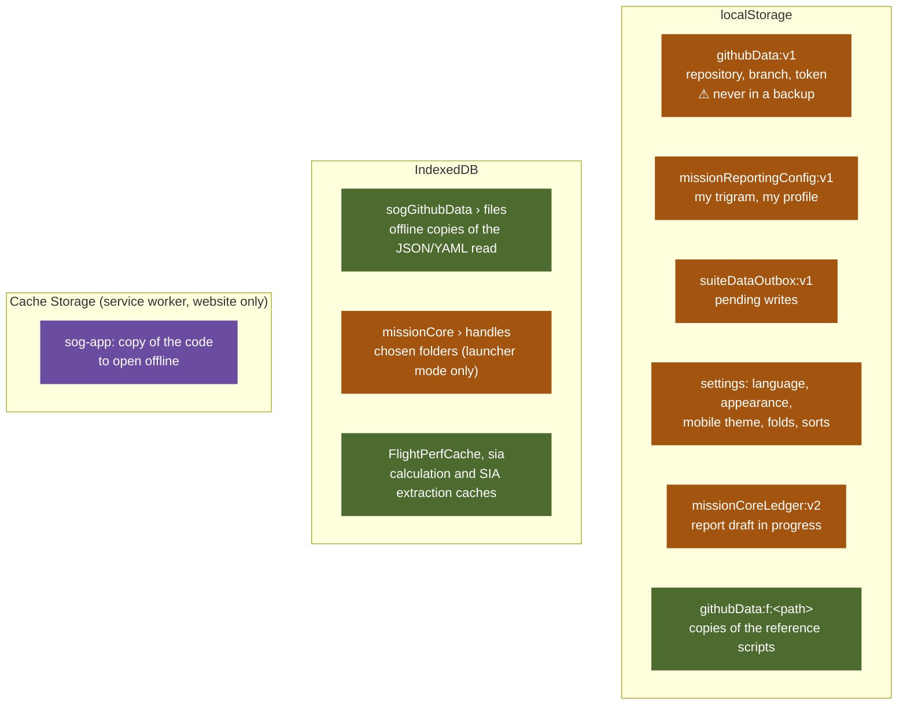
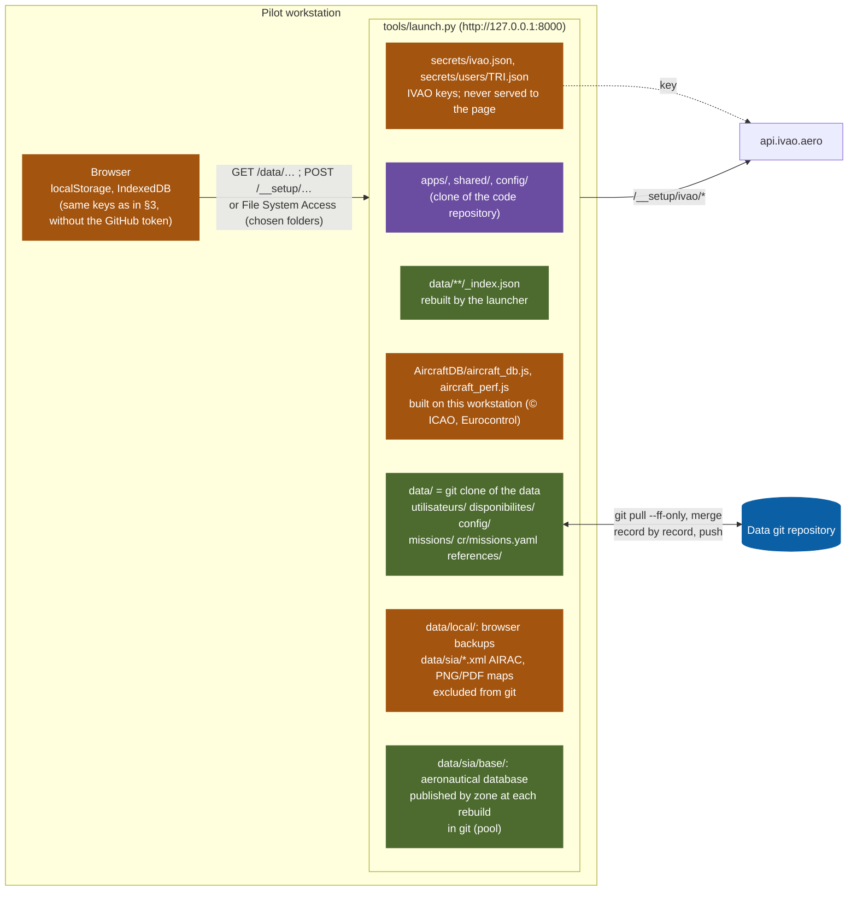
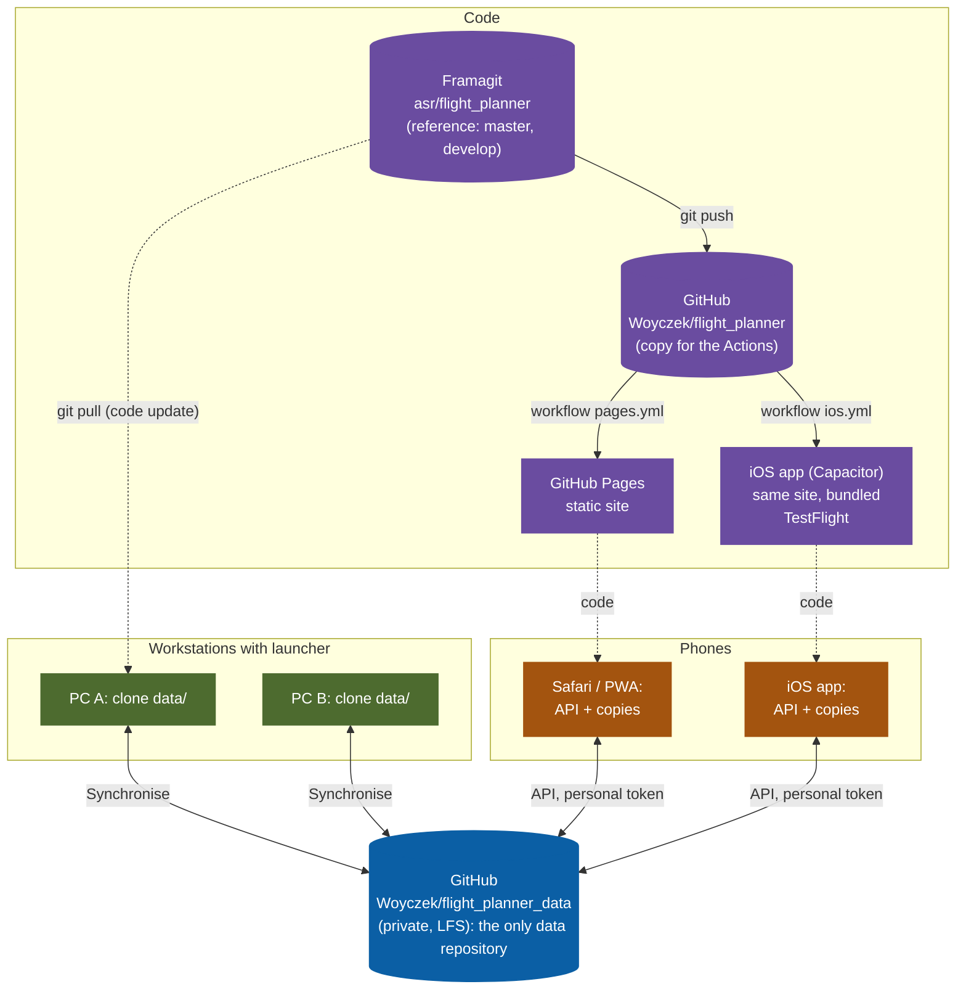

# Data and access: who stores what

*Version française : page de schémas remise à l'utilisateur ; ce document est la référence du dépôt.*

Who stores what, and how it is exchanged. Survey of the code as of 21 October 2026, describing branch
`feature/mobile`. The document starts with the "website / phone" mode, then the workstation with launcher, then the
decentralised overview.

Colour legend of the diagrams:

- blue: **shared**, the git data repository;
- green: **local copy** of a shared piece of data;
- orange: **specific** to a workstation or a browser;
- purple: **code** of the suite (no data).

Contents: 1. The principle: one git at the centre · 2. Website / phone mode · 3. What the browser keeps ·
4. Workstation with launcher · 5. Decentralised overview · 6. Table: shared or specific · 7. Known limits.

Related: stand-alone app plan (`APPLI_AUTONOME.md`), synchronisation (`SYNCHRONISATION.md`), data index
(`INDEX_DONNEES.md`).

## 1. The principle: one git at the centre

The suite strictly separates the **code** from the **data**. The reference code lives on Framagit
(`asr/flight_planner`, public); its copy on GitHub (`Woyczek/flight_planner`) only serves the Actions (Pages, iOS app).
The data have **a single repository**: `Woyczek/flight_planner_data` on GitHub, private (the former `missions-defa` on
Framagit was copied into it and is no longer used). The data repository is the only thing shared between the pilots. Everything else is a copy, a cache or a local setting.

Each workstation has its own complete copy of the data; the git repository is the meeting point. The phone has no
clone: it reads and writes the repository file by file, through the API.

## 2. Website / phone mode

The site `woyczek.github.io/flight_planner` contains **the code only** (built by `tools/build_pages.py`, without
`data/`). No server stores anything for you: GitHub Pages only distributes static files. The data comes straight from
the private repository, with your personal token.

The reference scripts (`references/aircraft_fleet.js`, `callsigns.js`, `data_tree.js`, `AircraftDB/*.js`) go through a
synchronous variant: the `localStorage` copy is taken up at once and refreshed afterwards; on the first visit, a
synchronous XHR request.

### Aeronautical (SIA) database

The phone has no SIA folder and never rebuilds the database: it reads the one **published** by a workstation. Each
rebuild on a workstation (Settings › Maintenance › Aeronautical data, or the map studio) also writes the database zone by
zone into the data folder: `sia/base/<zone>/<cycle>.json` (one active zone, plain JSON, no compression and no LFS: a few
hundred KB, up to about 5 MB for France) and `sia/base/cities.json` (GeoNames towns, about 4.7 MB). A file is rewritten
only when its content changes, and older cycles of the zone are removed. The same publication writes the format read
by V3 (`frame/aerodb/`), split by kind: `sia/base/<zone>/<cycle>/<kind>.json` (`airspaces`, `aerodromes`, `navaids`,
`points`, `vrp`, `airways`, `obstacles`, `mora`, `obstaclemax`, `cities` — the zone's towns — and `meta`: cycle, AAR
files, NAT tracks), `sia/base/cities_major.json` (towns over 100,000 inhabitants, for searches outside the loaded
zones) and the manifest `sia/base/index.json` (per zone: cycle, ICAO prefixes of its aerodromes, size of each file,
one-degree cells covered by its data;
zones published by other workstations kept). Both formats are written until the ergonomics session ends the old one;
"Synchronise" sends them (`sia/base` is part of
the pool of `tools/data_sync.py`; two workstations publishing the same file: the newer `updated_at` wins).

In GitHub mode `SiaBase.get()` (`shared/sia_base.js`) lists `sia/base/` in the git tree, reads every published zone
(latest cycle) through the diverted fetch (conditional requests: an unchanged file costs a 304), joins the zones back
into one database and keeps it in IndexedDB `sia-map-parser`, as on a workstation. The first page waits for it; later
pages use the stored copy and check the repository at most every 10 minutes (`siaBaseGh:v1`: files read and their ETag),
re-reading only when a published file changed. Each element goes to the zone of the file it came from; X-Plane data,
MORA cells and obstacle cells, which have no zone file, go to the zone that contains them. Joining the zones gives back
exactly the workstation's database (checked on 13 zones: 6,753 airspaces, same aerodromes, points, airways, obstacles,
MORA, refuelling and NAT tracks).

### Folder indexes

`disponibilites/_index.json` and `utilisateurs/_index.json` are **never in git**. On a workstation the launcher rebuilds
them from the folders, whatever file the clone holds, and `tools/data_sync.py` never commits them: an index still
tracked in the repository (written by an earlier version of the app) is untracked at the next "Synchronise" and never
blocks the merge. On the phone `github_data.js` always rebuilds them from the git tree (`git/trees?recursive=1`, one
request), never reads a copy from the repository, and `writeData` never writes them: writing an availability week or a
profile is one commit.

## 3. What the browser keeps (phone, iOS app, PC)

The browser of a phone and the WKWebView of the iOS app have the **same code and the same stores**; only the origin
differs (`woyczek.github.io` or `capacitor://localhost`), so the settings are not shared between the two.

The browser backup (`shared/browser_store.js`) takes the whole `localStorage` except the secret keys (`githubData:*`,
`defaCredentials:*`, `missionSendKey:*`) and the network tracking. It is written to `data/local/` of a workstation:
outside git.

## 4. Workstation with launcher

On a PC, `tools/launch.py` serves the code from the clone of the code repository and the data from `data/`, which is a
**git clone of the data repository**. The browser only talks to `127.0.0.1`; it is the launcher that talks to git and to
the external services.

The "Synchronise" button calls `tools/data_sync.py`: it only sends the pool folders, excludes `_index.json` and
`_conflits/`, and merges the JSON files record by record (by key) when two workstations wrote the same week.

### Two write paths on a workstation

- **Through the launcher** (`POST /__setup/…`): written to `data/`, then the indexes are rebuilt. This is the normal path
  of the pool pages (availability, profiles, mission orders).
- **Through a chosen folder** (File System Access, handles kept in IndexedDB `missionCore › handles`): report ledger,
  backup folder, X-Plane and SIA folders. Not compatible with Safari iOS, hence the GitHub mode for the phone.

## 5. Decentralised overview

Three kinds of nodes, a single shared place of truth. Each node can work cut off from the network and catches up
afterwards: through `git` on a workstation, through the write queue and the offline copies on a phone.

Workstations and phones converge on the same GitHub data repository: no divergence between two remotes is possible.
Each workstation must have this repository as its `sync-remote` (Installation › Sources); a workstation still pointed
at the former Framagit repository would write into the void.

## 6. Table: shared or specific

Scope: **shared** (the git data repository), **local copy** (of a shared piece of data), **specific** (to a workstation
or a browser), **code** (code of the suite, no data).

| Data | Where | Scope | Who writes |
|---|---|---|---|
| Pilot profiles `utilisateurs/TRI.json` | git data repository | shared | My profile (workstation or phone) |
| Availability `disponibilites/YYYY-Www.json` | git data repository | shared | My availability; record-by-record merge |
| Mission orders `missions/…` | git data repository | shared | CPCO (workstation); read-only on the phone |
| Report ledger `cr/missions.yaml` | git data repository | shared | Report; three-way merge |
| References `references/*.js`, `config/`, `data_tree.js` | git data repository | shared | Administration (workstation) |
| Aircraft database `AircraftDB/aircraft_db.js`, `aircraft_perf.js` | built on each workstation; published to `AircraftDB/` of the data repository for the phone (Maintenance › Aircraft types, “Publish the aircraft database to the data repository”: only these two files, plain values checked by `tools/data_guard.py`, plus their JSON copy `aircraft_db.json`, `aircraft_perf.json` read by V3) | specific → shared | Launcher; never published with the site |
| Indexes `_index.json` | workstation: `data/`; phone: rebuilt in memory | local copy | Launcher or `github_data.js` |
| Offline copies (IndexedDB `sogGithubData`, `githubData:f:*`) | browser | local copy | `github_data.js`; erased by "Cut access" |
| Offline code (Cache Storage `sog-app`) | browser (website) | code | service worker `sw.js` |
| GitHub token, repository, branch `githubData:v1` | browser | specific | My profile › Data access; not in the backup |
| My trigram `missionReportingConfig:v1`, language, appearance, mobile theme | browser | specific | Settings; in the browser backup |
| Queue `suiteDataOutbox:v1`, report draft `missionCoreLedger:v2` | browser | specific (transient) | Pages; emptied by "Synchronise" |
| Chosen folders (IndexedDB `missionCore › handles`) | workstation browser | specific | Installation; unusable on iOS |
| IVAO keys `secrets/` | workstation (files) | specific | Installation › Keys; never served, outside git and backups |
| Browser backups `data/local/` | workstation | specific | Save button; outside git |
| Aeronautical database `sia/base/<zone>/<cycle>.json`, `sia/base/cities.json`; split format (V3) `sia/base/<zone>/<cycle>/<kind>.json`, `sia/base/cities_major.json`, `sia/base/index.json` | git data repository | shared, produced by a workstation | Rebuild on a workstation (Maintenance, map studio), then Synchronise; read by phones and the website |
| SIA AIRAC `data/sia/*.xml`, maps `missions/**/*.png` | workstation | specific (regenerable) | SIA importer, studio; outside git |

## 7. Known limits

- **One token per browser.** The GitHub token gives write access to the whole data repository: a real multi-pilot
  deployment will need a server or signed accounts (workstream `feature/audit-securite`); study:
  `APPLI_AUTONOME_SECURITE.md`.
- **No sharing between Safari and the iOS app**: two origins, two sets of settings and copies.
- **Workstations to repoint**: a workstation whose `data/` still follows the former Framagit repository must change its
  remote (Installation › Sources › Data repository).
- **Mission maps and AIRAC source files** are absent from the data repository: "map not available" on the phone. The
  aeronautical database itself is published by zone (§ 2); rebuilding it remains a workstation function, and the phone
  has it only once a workstation has rebuilt and synchronised.
- **Import of the last IVAO flight**: needs the launcher's IVAO key, hence a workstation; on the phone, paste from the
  tracker.
