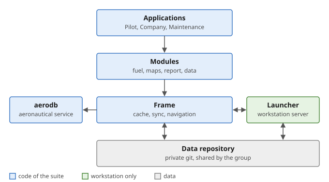
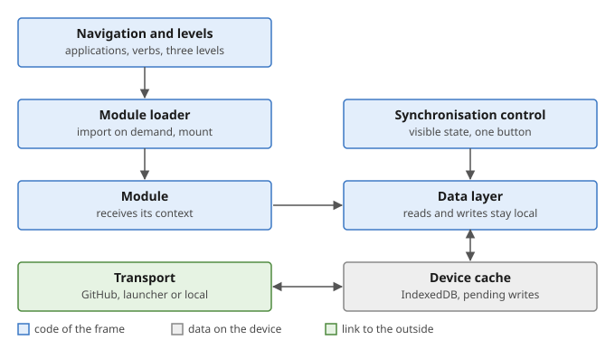
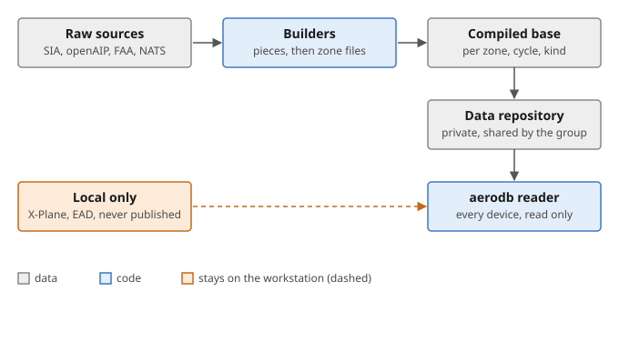
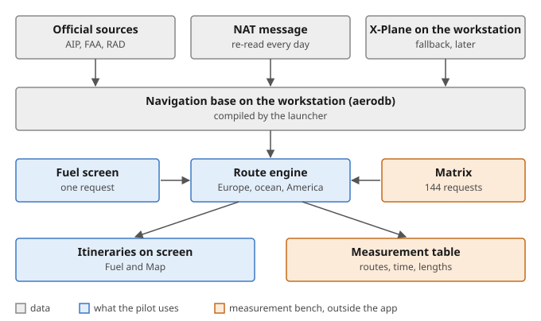
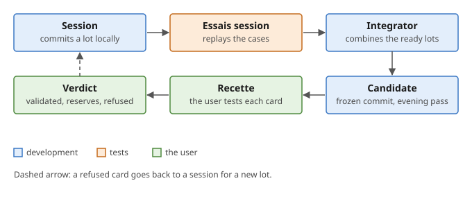

# V3 architecture at a glance

*Developer overview: five diagrams, each drawn from the documents named under it. It summarises; where a detail matters,
the linked document rules. What could not be confirmed in those documents is listed in [To confirm](#to-confirm).*

## 1. The suite at a glance

The suite separates **code** from **data**. The code is one public repository; the data is one private git repository,
the only thing shared between the pilots. Everything else on a device is a copy, a cache or a local setting.

An **application** (Pilot, Company, Maintenance) is a named set of modules of the same frame, chosen by the address of
the page (`/frame/?app=maintenance`; no `app` means Pilot). A **module** (`modules/<id>/module.js`) is loaded on demand
and receives a context from the **frame**: its part of the data layer, the aeronautical service **aerodb**, texts,
notifications, outgoing network calls. The frame reaches the data repository directly (GitHub API, on a phone or the
website) or through the **launcher**, the local server of a workstation, which also runs the jobs that only a workstation
can run (building the navigation base, reading PDFs). A phone has no clone: it reads and writes the repository file by
file.

CPCO and the SOG client are specified as further applications of the same frame; they are not built in V3 yet.

**Read next:** [V3_SPECIFICATION.md](V3_SPECIFICATION.md) §§ 2-4 · [DONNEES_ET_ACCES.md](DONNEES_ET_ACCES.md) ·
[frame/SPEC.md](../../frame/SPEC.md) § 3.1-3.2.

## 2. The frame

The heart of the frame is the data layer, and **disconnected mode is the normal state**. A read answers from the device:
the pending write if there is one, otherwise the cached copy. A write goes into the cache's queue only. The cache is one
IndexedDB database (`sogFrame`); a **transport** (GitHub, launcher, or local) talks to the outside.

Synchronisation is explicit and visible. One header button shows one state at a time (in progress, conflicts, on this
device, offline with the pending count, error, pending, up to date with its age). A pass runs at start, on the button,
every 10 minutes in the background while online, and when the network returns. It pulls the paths whose revision changed,
then sends all pending writes in **one commit**. A file changed on both sides is merged three-way; a losing version is
kept, never dropped.

Navigation lists the modules of the chosen application, one short verb each, seven at most. A module declares a level
(1 Everyday, 2 Advanced, 3 Full) and the menu lists it only when the device's level allows; a level is what a screen
offers, not a right. The loader unmounts the previous module, empties its element, then imports and mounts the next one
with its context.

**Read next:** [frame/SPEC.md](../../frame/SPEC.md) §§ 2.3, 3.1-3.3 · [frame/INTEGRATION.md](../../frame/INTEGRATION.md) §§ 6, 15 ·
[SYNCHRONISATION.md](SYNCHRONISATION.md) (the V2 synchronisation that the data layer replaces for V3 screens).

## 3. aerodb

aerodb answers every aeronautical question (airspaces, aerodromes, navaids, points, airways, obstacles, MORA, NAT tracks,
towns, aircraft types) from bases **published** to the data repository by a workstation with the launcher. It never reads
the raw sources and never builds. **Compiling and using are two separate things**: compiled files are kept in the private
repository (marked outdated rather than removed), raw sources never are.

Compilation runs on the owner's order from the Data module. One builder per source makes a *piece*; one assembler per zone
merges the pieces with the priority rule into `sia/base/<zone>/<cycle>/<kind>.json`, plus an index, a `meta.json` and a
manifest. Builders return files; the launcher (or the frame's publication service, without a launcher) writes and commits.
Workers do the JavaScript sources; the launcher's Python jobs do the PDF and network-bound ones.

**Publishable to the group:** the compiled zone files and the manifest, built from the free or open sources. Sources with a
personal licence (ENAIRE, NATS) are dropped from a published build unless the owner ticks them. **Local or personal:** X-Plane
and Navigraph inputs are dropped when the output is to be published; the converted X-Plane procedures (`proc/local/`) never
leave the workstation and rank lowest; EAD downloads and the eAIP cache stay under the workstation's local data folder; the
Sources screen marks such a source "read on this workstation only".

**Read next:** [frame/aerodb/SPEC.md](../../frame/aerodb/SPEC.md) §§ 1, 5 quinquies, 5 septies, 6 ·
[V3_DONNEES_REGENERATION.md](V3_DONNEES_REGENERATION.md) § 0 · [V3_APP_DONNEES.md](V3_APP_DONNEES.md) § 0 ·
[frame/aerodb/INTEGRATION.md](../../frame/aerodb/INTEGRATION.md).

## 4. The route engine and the matrix

Official sources (AIP, FAA, RAD), the NAT message (re-read every day) and, as a later fallback, X-Plane on the workstation
feed one navigation base, compiled by the launcher. That base feeds the **route engine** (Europe, ocean, America). Two callers
use it: the Fuel screen, with one request, and the matrix, with 144. The engine returns itineraries to the screens (Fuel and
Map) and a table of measures to the bench (routes, time, lengths).

The matrix (`tools/route_matrix.py`) is a **measurement bench, not part of the app**. It replays 144 crossings (six European
and six North American aerodromes, both directions, one departure inside the NAT window and one twelve hours away) offline,
with the network refused: the NAT tracks it uses are the ones already in the base. It is run before pushing a change to
the ocean algorithm, and should be run against several NAT messages, including an empty one. It is not needed at each new NAT
message or AIRAC cycle. The acceptance is that every request returns a route or a named reason, none returns a "proposal",
and none is a direct over 200 NM without its reason.

**Read next:** [V3_ROUTE_GATES.md](V3_ROUTE_GATES.md) §§ 1, 3, 13.3 · [V3_ROUTES_PROCEDURES_ETAT.md](V3_ROUTES_PROCEDURES_ETAT.md) ·
[frame/aerodb/INTEGRATION.md](../../frame/aerodb/INTEGRATION.md) (the matrix table).

## 5. How a change is delivered

A session works on one **lot**: free local commits, with the lot's documents (manuals, CHANGELOG entry) in the same commit.
The cases that concern the lot are replayed by the **Essais** test session. When the lot is ready it is reported with its
commit hash and pushed; one owner per set of files keeps sessions from overwriting one another.

The integrator (the ergonomics session) combines the ready lots, freezes a **candidate** commit and runs one pass of the
non-regression suite on it (`tests/v3/run.py`, first `--touched <base>`, then `--all`); a failure blocks the candidate. The
user then tests in **Recette**, a frame screen that lists one functional test per delivered card and records a verdict for
each: validated, accepted with reservations (a comment is required), or refused (a comment is required, and the test comes
back). A refusal feeds a new lot.

**Read next:** [`.claude/agents/README.md`](../../.claude/agents/README.md) (sessions, lots, synchronisation) ·
[`CLAUDE.md`](../../CLAUDE.md) (rules before each commit) · [`tests/v3/README.md`](../../tests/v3/README.md) ·
[frame/help/SPEC.md](../../frame/help/SPEC.md) (the Recette screen).

## To confirm

- **Diagram 5, box "Essais session"**: confirmed by the ergonomics session. Since 16 November 2026 the sessions no longer
  run the cases themselves: a dedicated test session queues the requests and replays one at a time; the documents of
  each zone still describe the former practice and are to be updated by their owners.
- **Diagram 4, aerodromes of the matrix**: `V3_ROUTE_GATES.md` § 13.3 names KIAD and CYUL among the six North American
  aerodromes; `tools/route_matrix.py` lists KLAX and KSFO instead. The text says "six" without naming them.
- **Section 4, how the matrix is run**: decided by the ergonomics session on 17 November 2026 (card SOG-0396), not yet
  written in `V3_ROUTE_GATES.md`: run before pushing a change to the ocean algorithm, against several NAT messages
  including an empty one; one pass at a time, on the ergonomics session's word.
- **Diagram 4, "NAT message (re-read every day)"** and **"X-Plane on the workstation (fallback, later)"**: the documents say
  the NAT message of the day is already read by `nat_layer.py` and that X-Plane is a local fallback; "every day" and "later"
  are not stated there.
- **Diagram 4, "Fuel screen: one request"** and **"Navigation base ... compiled by the launcher"**: taken from the brief; the
  documents say the base is built by builders run through a launcher job, and do not describe the Fuel screen's call count.
- **Diagram 1, data repository and code repository**: `DONNEES_ET_ACCES.md` describes branch `feature/mobile` as of 21 October
  and `SYNCHRONISATION.md` describes the V2 mechanism with another remote; no current V3 document restates which hosts are
  used, so none is named here.
- **Diagram 1, applications**: only Pilot, Company and Maintenance exist in `frame/app.js` per `frame/SPEC.md`; CPCO and the
  SOG client are in `V3_SPECIFICATION.md` § 2 as specified, not built.
