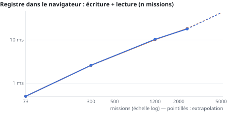

# Performance report

Generated by `python tools/perf_report.py` from `docs/perf/runs/` (method and action plan:
[PLAN_PERF_2026-10-04.md](PLAN_PERF_2026-10-04.md)). Orange bars: before; blue: after.

## Summary (4 October 2026, branch `feature/perf-audit`)

**What was done.** The seven priority-1 actions of the plan, plus two fixes found by the "after" audit:
a memoised read that re-read a missing key twice (routing settings: 440 JSON parses each time the
registry was opened) and a translation-prefix lookup that went through every known line for each unknown
text (now indexed by first word).

**How it is measured.** The same click path (My missions, ODV, registry, generator, studio, reports, Settings),
with a server and without a server (folders simulated as under `file://`). Before and after **alternated** (before, after, before,
after…), three runs each, **median per step**, page visible, same probe on both sides. Timings for one and the same
measurement vary by up to ±30% from one run to the next on this machine: only the counters (requests, parses,
opens…) are exact; timings should be read as trends.

**Gains over the path** (totals, server / no server):

| | before | after |
|---|---:|---:|
| IndexedDB opens | 213 / 51 | 17 / 19 (−92% / −63%) |
| JSON parses | 690 / 5,296 | 465 / 435 (−33% / −92%) |
| requests | 146 / 129 | 79 / 110 (−46% / −15%) |
| 404 requests | 86 / 9 | 15 / 9 (−83%) |
| translation passes | 236 / 247 | 79 / 84 (−67%) |
| translation time | 709 / 727 ms | 140 / 141 ms (−80%) |
| observer callbacks | 1,365 / 1,831 | 570 / 817 (−58%) |

**What did not change.** Blocking time (long tasks) stays at ≈ 255 ms over the whole path: it comes from the
map studio (≈ 300 ms on load, building the SIA database) and from Settings, which were not touched. Storage
reads (`getItem`) are stable: they remain, but are no longer followed by a JSON parse. Cost of the
observers themselves: 1 → 5 ms over the whole path (the single translator records the modified nodes), negligible.

**Scaling.** Two curves change slope:

- route estimate: 22.8 → 0.9 ms per estimate at 2,400 missions (× 25), and the registry is no longer re-parsed on
  each estimate;
- translation: 290 → 24 ms per pass at 8,000 texts (× 12); extrapolated to 30,000 texts: 0.95 s → 55 ms.

The others are **unchanged** (linear, not addressed) and indicate the next breaking points:

| Case | Today | At 20,000 | Problem threshold |
|---|---|---|---|
| Report registry (a single `missions.yaml`) | 13 ms (100 reports) | ≈ 2.5 s on every report / reporting page | ≈ 3,000 reports (0.5 s) |
| ODV grid (50 pilots × 21 slots) | 7 ms (500 assignments) | ≈ 240 ms per displayed week | ≈ 40,000 assignments |
| Browser registry (≈ 2.7 KB per mission) | 219 KB (73 missions) | — | **browser storage quota** (5 to 10 MB depending on the browser; the measurement panel allows more, so the bench does not see it): reached between ≈ 1,900 and 3,800 missions, and writing the registry then fails **without any message** |
| Assignment index (My missions) | < 1 ms | 17 ms | not before 100,000 |

**Proposed next** (priority 2 of the plan, to be decided): a slimmed-down browser registry (≈ 0.5 KB per mission instead of
3 KB, details read from the files — pushes the quota beyond 10,000 missions — and a warning if
the write fails); report registry split by year with an
index; ODV grid indexed by pilot and by day; mission folder signatures written to
`data/missions/` so that another workstation benefits from incremental re-reading; and, outside the plan, building the
map studio's SIA database as a background task (the only notable blocking left).

## Click path — server

Before: "before" (4f0b0283, 3 run(s)) — after: "after" (c683ddd5, 3 run(s)). Several runs: median per step.

| indicator (path total) | before | after | difference |
|---|---:|---:|---:|
| time to stable page (ms) | 10017 | 9506 | -5% |
| blocking time (long tasks, ms) | 275 | 254 | -8% |
| timer delay > 50 ms (ms) | 641 | 611 | -5% |
| requests | 146 | 79 | -46% |
| 404 requests | 86 | 15 | -83% |
| IndexedDB opens | 213 | 17 | -92% |
| JSON parses | 690 | 465 | -33% |
| storage reads | 918 | 911 | -1% |
| translation passes | 236 | 79 | -67% |
| translation (ms) | 709 | 140 | -80% |
| block icons (ms) | 197 | 196 | 0% |
| decorations (ms) | 187 | 176 | -6% |
| observer callbacks | 1365 | 570 | -58% |
| observers (ms) | 1 | 5 | +308% |
| storage writes | 15 | 15 | 0% |

"Time to stable page" includes intended delays (animations, batching): the counters above measure
the work actually done.

## Click path — no server

Before: "before" (4f0b0283, 3 run(s)) — after: "after" (c683ddd5, 3 run(s)). Several runs: median per step.

| indicator (path total) | before | after | difference |
|---|---:|---:|---:|
| time to stable page (ms) | 11615 | 10911 | -6% |
| blocking time (long tasks, ms) | 258 | 257 | 0% |
| timer delay > 50 ms (ms) | 544 | 564 | +4% |
| requests | 129 | 110 | -15% |
| 404 requests | 9 | 9 | 0% |
| IndexedDB opens | 51 | 19 | -63% |
| JSON parses | 5296 | 435 | -92% |
| storage reads | 1306 | 1293 | -1% |
| files read (folder) | 296 | 290 | -2% |
| folder listings | 146 | 146 | 0% |
| translation passes | 247 | 84 | -66% |
| translation (ms) | 727 | 141 | -81% |
| block icons (ms) | 211 | 200 | -5% |
| decorations (ms) | 199 | 186 | -7% |
| observer callbacks | 1831 | 817 | -55% |
| observers (ms) | 2 | 5 | +240% |
| storage writes | 19 | 19 | 0% |

"Time to stable page" includes intended delays (animations, batching): the counters above measure
the work actually done.

## Scaling

Synthetic data of increasing size, real functions of the suite; fit `t = a·n^b` and extrapolation.

| case | b before | b after | extrapolated before | extrapolated after |
|---|---:|---:|---|---|
| My missions: read the index and pick one's missions (n assignments) | 0.95 | 0.95 | 5000 → 4.7 ms, 20000 → 17.6 ms, 100000 → 81.3 ms | 5000 → 4.6 ms, 20000 → 17.1 ms, 100000 → 78.3 ms |
| ODV: week grid, 50 pilots × 21 slots (n assignments) | 0.90 | 0.96 | 5000 → 64.6 ms, 20000 → 224.3 ms, 100000 → 950.6 ms | 5000 → 63.2 ms, 20000 → 238.4 ms, 100000 → 1113 ms |
| Registry in the browser: write + read (n missions) | 1.03 | 1.03 | 500 → 3.9 ms, 2000 → 16.5 ms, 5000 → 42.6 ms | 500 → 3.9 ms, 2000 → 16.5 ms, 5000 → 42.4 ms |
| Route estimate for one mission with a registry of n missions | 1.10 | 1.12 | 500 → 4 ms, 2000 → 18.2 ms, 5000 → 49.7 ms | 500 → 0.1 ms, 2000 → 0.6 ms, 5000 → 1.7 ms |
| Report registry: read missions.yaml (n reports) | 0.91 | 1.00 | 1000 → 134.2 ms, 5000 → 579.1 ms, 20000 → 2040.3 ms | 1000 → 122.8 ms, 5000 → 614.7 ms, 20000 → 2460.5 ms |
| Translation layer: one pass over n texts (500 known lines) | 0.97 | 0.69 | 3000 → 102.3 ms, 10000 → 328.3 ms, 30000 → 951 ms | 3000 → 11.2 ms, 10000 → 25.6 ms, 30000 → 54.6 ms |

Measured volumes:

- Registry in the browser: write + read (n missions) (before): 73 → 219 KB, 300 → 798 KB, 1200 → 3195 KB, 2400 → 6392 KB
- Registry in the browser: write + read (n missions) (after): 73 → 219 KB, 300 → 798 KB, 1200 → 3195 KB, 2400 → 6392 KB
- Report registry: read missions.yaml (n reports) (before): 100 → 332 KB, 500 → 1661 KB, 2000 → 6646 KB, 6000 → 19939 KB
- Report registry: read missions.yaml (n reports) (after): 100 → 332 KB, 500 → 1661 KB, 2000 → 6646 KB, 6000 → 19939 KB

