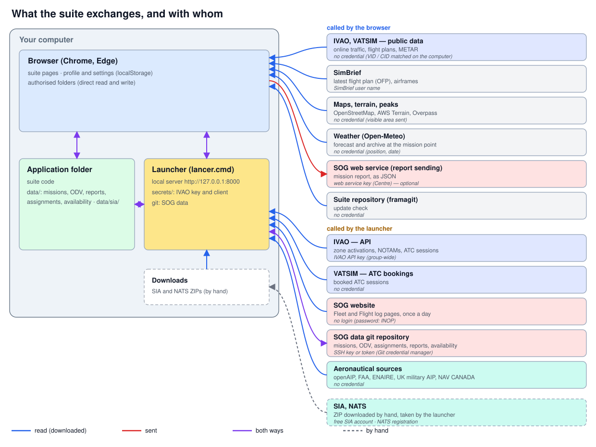
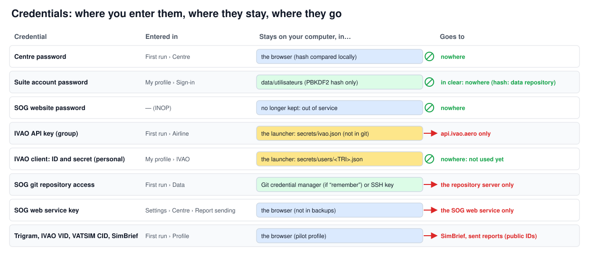

# Installing the SOG suite — tutorial

*SO Group Virtual (Virtual Special Operation Group) · version 4.10 · [Version française](installation.fr.md)*

Ten minutes are enough: start the suite, follow the six steps of the **First run** page, and each step gets ticked in
the summary at the top of the page. The screenshots come from a fresh installation with the sample data (fictitious
pilot ALF).

## 1. How it works

The suite runs **entirely on your computer**. Nothing is hosted by a third party:

- the **browser** (Chrome or Edge) displays the pages and keeps your profile and settings;
- the **launcher** (`lancer.cmd`, or `lancer.sh` on macOS and Linux) serves these pages on `http://127.0.0.1` and does
  what the browser cannot do alone: query a service that needs a key, read a file from Downloads, synchronise the data
  with git;
- the **application folder** holds the suite code and, in `data/`, the SOG data (missions, ODV, assignments, reports,
  availability) and the aeronautical data (`data/sia/`).



A few services are queried **directly by the browser**: they are public and need no credential (IVAO and VATSIM
traffic, map backgrounds, terrain, weather, SimBrief). The others go **through the launcher**: the IVAO API (with the
group key), VATSIM ATC bookings, the Fleet and Flight log pages of the SOG website (read once a day, without logging
in), the SOG data git repository, and the downloadable aeronautical sources (openAIP, FAA, ENAIRE, UK military AIP,
NAV CANADA). Two sources are downloaded by hand because they require an account: the **SIA** (free) and **NATS**; the
launcher then takes their ZIPs from the Downloads folder.

### Your credentials stay with you



- **Passwords are kept on your computer and sent nowhere.** The Centre password is checked in the browser; your suite
  account password is never kept in clear (only its hash is); the SOG website password is **out of service** (INOP)
  until the SOG has a web service.
- **A key only goes to its own service**: the IVAO API key to `api.ivao.aero`, git access to the repository server,
  the SOG web service key to that web service. IVAO keys are kept by the launcher (`secrets/`, never in git, never in
  backups, never sent back to the page); git access by Git's credential manager, if you tick “remember”.
- Your network IDs (IVAO VID, VATSIM CID) and SimBrief name are **public**: they are used to find your flights and
  flight plans.

## 2. Before you start

Nothing is required to discover the suite with the sample data. To use it within the SOG, gather the following —
**ask the SOG administrators** for what is marked “provided by the admins”.

### User

| Item | Where to get it | Where to enter it | |
|---|---|---|---|
| **Trigram** (your SOG user name) | provided by the SOG admins | First run › Profile | recommended |
| **SOG git repository address** and your access (SSH key or token) | provided by the admins; an SSH key is created with `ssh-keygen` and declared on the repository server | First run › Data | recommended |
| **IVAO VID** and **VATSIM CID** | your IVAO and VATSIM accounts | First run › Profile | recommended |
| **SimBrief user name** | your SimBrief account | First run › Profile | optional |
| **Personal IVAO client** (Client Credentials: *client ID* and *client secret*) | to create on [developers.ivao.aero](https://developers.ivao.aero), in your name | Settings › My profile › IVAO | optional (upcoming feature) |
| **SIA account** | free, on the SIA website (shop) | — (ZIP download) | recommended |
| **X-Plane folder** | your X-Plane installation | Aeronautical data › X-Plane | optional |

### SOG administrator (once for the whole group)

| Item | How to create it | Where to enter it | |
|---|---|---|---|
| Group **IVAO API key** | on [developers.ivao.aero](https://developers.ivao.aero), signed in with an SOG IVAO account: create an application and get its *API key*; pass it on to members | First run › Airline, or Settings › Installation › API keys | recommended |
| **SOG data git repository** | **private** repository (framagit, gitnet…) created by an admin; push `data/` to it; give each member read and write access (SSH key or token) | First run › Data | recommended |
| SOG website **“Fleet” page** and **“Flight log” page** | website addresses (by default `https://flotte.defa-virtual.fr/flotte.php` and `/log_vols.php`) | Settings › Installation › Virtual airline | set by default |
| **Centre password** | provided by the SOG admins | First run › Centre | admins only |
| **SOG web service** (report sending) | does not exist yet; when it does, an address and an API key | Settings › Centre › Report sending | upcoming |

At IVAO, the key and the client are created from the developer portal, which requires an IVAO account: its screens
may change. For a personal client, declare at IVAO the **redirect URL** the suite shows in My profile (for example
`http://127.0.0.1:8000/__setup/ivao-callback`).

**Browser**: recent Chrome or Edge. Brave works after one setting (see [INSTALL.md](../INSTALL.md)); Firefox and Safari
cannot write to a folder.

## 3. Step-by-step installation

### 3.1 Start the suite

Unzip the suite archive wherever you like (for example `E:\SOG`), then double-click **`lancer.cmd`** (Windows) — or
`sh lancer.sh` in a terminal (macOS, Linux). The launcher installs Python if it is missing (with your agreement),
starts the local server and opens the **First run** page. Its console messages are in French:

```text
X-Plane Web Suite — lanceur
Dossier : E:\SOG

1. Données (dossier data/)
  Données pas encore là : la page de premier lancement propose le jeu d’essai, l’adresse de votre dépôt de données
  ou l’archive reçue.
2. Serveur local
  Suite servie sur http://127.0.0.1:8000/
3. Navigateur
  http://127.0.0.1:8000/apps/settings/premier_lancement.html
```

Keep this window open while you use the suite: closing it stops the suite.


The **summary** at the top of the page shows what is done (✓), what is left (○) and what is optional (–). Each line
leads to its step; you can come back at any time through Settings › First run.


### 3.2 Step 1 — Application folder

Everything else stays greyed out until this folder is chosen: the suite must be able to read and write its data.


Click **Choose the application folder** and pick the folder that contains `lancer.cmd`. Chrome asks for permission to
edit the files in that folder: **Allow** (choose “Allow on every visit” if Chrome offers it: it will not ask again).


If the folder you pick belongs to **another copy** of the suite, the page says so (“Suite launched from …, declared
folder …”): pick the folder of the copy you have just started. After a restart, Chrome may ask for access again: one
click on **Grant access again** is enough.

### 3.3 Step 2 — Data


Three options:

- **Sample data**: fictitious data to discover the suite (12 missions, 4 pilots, dated availability and assignments).
  To be replaced later by the SOG's data.
- **Data repository**: the address of the SOG git repository (`https://…` or `git@…`), provided by the admins, then
  **Fetch the data**. Over HTTPS, the login and the password or token are only used for the download; “remember” hands
  them to Git's credential manager. Over SSH, the computer's SSH key is used.
- **Archive received by e-mail**: the data `.zip`.


The **sync git repository** (optional) then shares the data between computers, through the **Synchronise** button in
the header.

### 3.4 Step 3 — Airline


The airline name and website address are already set for the SOG. The **IVAO API key** (provided by the admins) lets
the suite import IVAO zone activations and ATC sessions into the Board and the ODV planning; without it, they are
entered by hand. It is kept by the launcher and never shown again (only its last 4 characters).

### 3.5 Step 4 — Profile


Your **trigram**, **IVAO VID**, **VATSIM CID**, **SimBrief** user name, and your **login** on the SOG website. The suite
never asks for your IVAO or VATSIM passwords. The **SOG website password** is out of service (**INOP**): it is neither
asked for nor kept until the SOG has a web service.

### 3.6 Step 5 — Aeronautical data

Maps, the studio and planning use the aeronautical data (AIRAC cycle). On the map, **click the countries you want**
(one click adds, another removes), then **Activate**: the suite downloads their sources, rebuilds the aeronautical
database and computes the MORA. France is chosen by default.


What cannot be done automatically is listed under the map, **Actions to do**:


- **SIA**: order the current cycle on the SIA shop (free account, €0 product), download the ZIP, then **Take the latest
  ZIP** — the launcher takes it from Downloads (if it is already there, “Activate” takes it by itself);
- **DIRCAM** (air refuelling tracks): download the MILAIP PDF (ENR 5.7), then **Import the PDF**;
- **X-Plane** (optional): **Choose the folder** of your X-Plane installation.


### 3.7 Step 6 — Centre (administrators)

The Centre (mission generation, map studio, registry, Board, ODV planning) is restricted: it is enabled with the Centre
password, provided by the admins.


Once enabled, the step offers the fleet and flight log update from the SOG website, the registry missions and the SOG
settings.


### 3.8 Finish

When the summary is green for what concerns you, click **Finish**: from then on the suite opens on the home page, with
a banner as long as something is left to set.


## 4. Further settings

### My profile

The SOG website account (login; password INOP) and the **personal IVAO client**: *client ID*, *client secret*, and the
redirect URL to declare at IVAO.


### Installation

**External sources** (addresses of the SOG website, the SIA, the DIRCAM…), **API keys** (IVAO, for the whole
installation) and **Virtual airline** (names and website pages: Fleet, Flight log).


### Centre (administrators)

**Users and rights**, **Report sending** (address and key of the SOG web service, once it exists) and **Fleet**.


## 5. Troubleshooting

| Symptom | What to do |
|---|---|
| Everything is greyed out | Step 1: choose the application folder, or **Grant access again** |
| “Suite launched from …, declared folder …” | The folder belongs to another copy: choose the one of the suite you started |
| “SIA folder not authorised” | Give access to the application folder again (step 1) |
| The page does not open | Check that the launcher window is open; open the address it shows |
| An old version is still displayed | Ctrl+F5 |

Further reading: [User manual](../en/MANUEL_UTILISATEUR.md), [Administrator manual](../en/MANUEL_ADMINISTRATEUR.md),
[detailed installation](../INSTALL.md) (in French).
