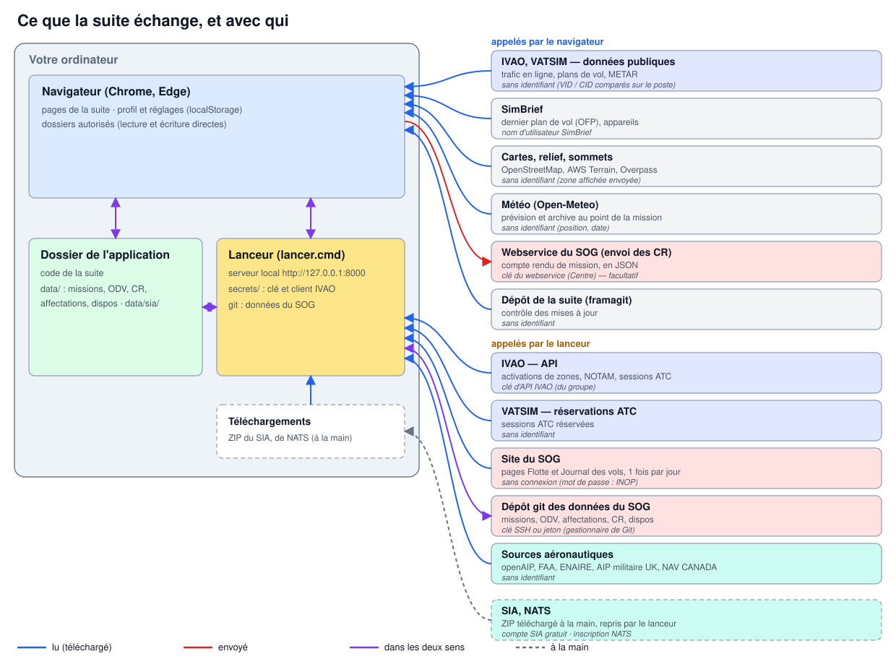
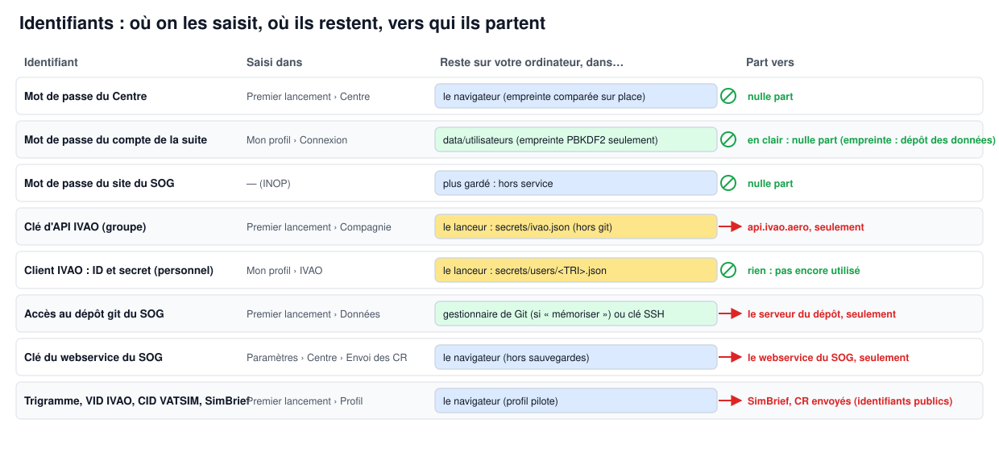

# Installer la suite SOG — tutoriel

*SO Group Virtual (Virtual Special Operation Group) · version 4.10 · [English version](installation.en.md)*

Dix minutes suffisent : on lance la suite, on suit les six étapes de la page **Premier lancement**, et chaque étape se
coche dans le bilan en tête de page. Les captures de ce tutoriel viennent d'une installation neuve avec le jeu d'essai
(pilote fictif ALF).

## 1. Comment ça marche

La suite tourne **entièrement sur votre ordinateur**. Rien n'est hébergé chez un tiers :

- le **navigateur** (Chrome ou Edge) affiche les pages et garde votre profil et vos réglages ;
- le **lanceur** (`lancer.cmd`, ou `lancer.sh` sous macOS et Linux) sert ces pages sur `http://127.0.0.1` et se charge
  de ce que le navigateur ne peut pas faire seul : interroger un service qui demande une clé, lire un fichier de
  Téléchargements, synchroniser les données avec git ;
- le **dossier de l'application** contient le code de la suite et, dans `data/`, les données du SOG (missions, ODV,
  affectations, comptes rendus, disponibilités) et les données aéronautiques (`data/sia/`).



Quelques services sont interrogés **directement par le navigateur** : ils sont publics et ne demandent pas
d'identifiant (trafic IVAO et VATSIM, fonds de carte, relief, météo, SimBrief). Les autres passent **par le
lanceur** : l'API IVAO (avec la clé du groupe), les réservations ATC de VATSIM, les pages Flotte et Journal des vols du
site du SOG (lues une fois par jour, sans connexion), le dépôt git des données du SOG, et les sources aéronautiques
téléchargeables (openAIP, FAA, ENAIRE, AIP militaire britannique, NAV CANADA). Deux sources se téléchargent à la main,
parce qu'elles demandent un compte : le **SIA** (gratuit) et **NATS** ; le lanceur reprend ensuite leurs ZIP dans le
dossier Téléchargements.

### Vos identifiants restent chez vous



- **Les mots de passe sont gardés sur votre ordinateur et ne sont envoyés nulle part.** Le mot de passe du Centre est
  vérifié dans le navigateur ; celui de votre compte de la suite n'est jamais conservé en clair (seule son empreinte
  est gardée) ; le mot de passe du site du SOG est **hors service** (INOP) tant que le SOG n'a pas de webservice.
- **Une clé ne part que vers son propre service** : la clé d'API IVAO vers `api.ivao.aero`, l'accès git vers le
  serveur du dépôt, la clé du webservice du SOG vers ce webservice. Les clés IVAO sont gardées par le lanceur
  (`secrets/`, jamais dans git, jamais dans les sauvegardes, jamais renvoyées à la page) ; l'accès git par le
  gestionnaire d'identifiants de Git, si vous cochez « mémoriser ».
- Vos identifiants de réseau (VID IVAO, CID VATSIM) et SimBrief sont **publics** : ils servent à retrouver vos vols et
  vos plans de vol.

## 2. Avant de commencer

Rien n'est obligatoire pour découvrir la suite avec le jeu d'essai. Pour l'utiliser au sein du SOG, réunissez ce qui
suit — **demandez aux administrateurs du SOG** ce qui est marqué « fourni par les admins ».

### Utilisateur

| Élément | Où l'obtenir | Où le saisir | |
|---|---|---|---|
| **Trigramme** (votre nom d'utilisateur SOG) | fourni par les admins du SOG | Premier lancement › Profil | conseillé |
| **Adresse du dépôt git du SOG** et votre accès (clé SSH ou jeton) | fourni par les admins ; une clé SSH se crée avec `ssh-keygen` puis se déclare sur le serveur du dépôt | Premier lancement › Données | conseillé |
| **VID IVAO** et **CID VATSIM** | vos comptes IVAO et VATSIM | Premier lancement › Profil | conseillé |
| **Nom d'utilisateur SimBrief** | votre compte SimBrief | Premier lancement › Profil | facultatif |
| **Client IVAO personnel** (Client Credentials : *client ID* et *client secret*) | à créer sur [developers.ivao.aero](https://developers.ivao.aero), à votre nom | Paramètres › Mon profil › IVAO | facultatif (fonction à venir) |
| **Compte SIA** | gratuit, sur le site du SIA (boutique) | — (téléchargement du ZIP) | conseillé |
| **Dossier d'X-Plane** | votre installation d'X-Plane | Données aéronautiques › X-Plane | facultatif |

### Administrateur du SOG (une fois pour tout le groupe)

| Élément | Comment le créer | Où le saisir | |
|---|---|---|---|
| **Clé d'API IVAO** du groupe | sur [developers.ivao.aero](https://developers.ivao.aero), connecté avec un compte IVAO du SOG : créer une application et récupérer sa clé d'API (*API key*) ; la transmettre aux membres | Premier lancement › Compagnie, ou Paramètres › Installation › Clés d'API | conseillé |
| **Dépôt git des données du SOG** | dépôt **privé** (framagit, gitnet…) créé par un admin ; y pousser `data/` ; donner un accès en lecture et écriture à chaque membre (clé SSH ou jeton) | Premier lancement › Données | conseillé |
| **Page « Flotte »** et **page « Journal des vols »** du site du SOG | adresses du site (par défaut `https://flotte.defa-virtual.fr/flotte.php` et `/log_vols.php`) | Paramètres › Installation › Compagnie virtuelle | réglées par défaut |
| **Mot de passe du Centre** | fourni par les admins du SOG | Premier lancement › Centre | admins seulement |
| **Webservice du SOG** (envoi des comptes rendus) | n'existe pas encore ; le jour venu, une adresse et une clé d'API | Paramètres › Centre › Envoi des comptes rendus | à venir |

Chez IVAO, la clé et le client se créent depuis le portail des développeurs, réservé aux comptes IVAO : ses écrans
peuvent changer. Pour un client personnel, déclarez chez IVAO l'**adresse de redirection** que la suite affiche dans
Mon profil (par exemple `http://127.0.0.1:8000/__setup/ivao-callback`).

**Navigateur** : Chrome ou Edge récents. Brave fonctionne après un réglage (voir [INSTALL.md](../INSTALL.md)) ; Firefox
et Safari ne peuvent pas écrire dans un dossier.

## 3. Installation pas à pas

### 3.1 Lancer la suite

Décompressez l'archive de la suite où vous voulez (par exemple `E:\SOG`), puis double-cliquez sur **`lancer.cmd`**
(Windows) — ou `sh lancer.sh` dans un terminal (macOS, Linux). Le lanceur installe Python s'il manque (avec votre
accord), démarre le serveur local et ouvre la page **Premier lancement** :

```text
X-Plane Web Suite — lanceur
Dossier : E:\SOG

1. Données (dossier data/)
  Données pas encore là : la page de premier lancement propose le jeu d’essai, l’adresse de votre dépôt de données
  ou l’archive reçue.
2. Serveur local
  Suite servie sur http://127.0.0.1:8000/
3. Navigateur
  http://127.0.0.1:8000/apps/settings/premier_lancement.html
```

Laissez cette fenêtre ouverte pendant l'utilisation : la fermer arrête la suite.


Le **bilan** en tête de page montre ce qui est fait (✓), ce qui reste à faire (○) et ce qui est facultatif (–). Chaque
ligne mène à son étape ; on peut y revenir à tout moment par Paramètres › Premier lancement.


### 3.2 Étape 1 — Dossier de l'application

Tout le reste est grisé tant que ce dossier n'est pas choisi : la suite doit pouvoir lire et écrire ses données.


Cliquez sur **Choisir le dossier de l'application** et désignez le dossier qui contient `lancer.cmd`. Chrome demande
l'autorisation de modifier les fichiers de ce dossier : **Autoriser** (choisissez « Autoriser à chaque visite » si
Chrome le propose : il ne la redemandera plus).


Si le dossier désigné est celui d'une **autre copie** de la suite, la page le signale (« Suite lancée depuis …, dossier
déclaré … ») : choisissez celui de la copie que vous venez de lancer. Après un redémarrage, Chrome peut redemander
l'accès : un clic sur **Autoriser à nouveau** suffit.

### 3.3 Étape 2 — Données


Trois possibilités :

- **Jeu d'essai** : des données fictives pour découvrir la suite (12 missions, 4 pilotes, des disponibilités et des
  affectations datées). À remplacer plus tard par celles du SOG.
- **Dépôt de données** : l'adresse du dépôt git du SOG (`https://…` ou `git@…`), fournie par les admins, puis
  **Récupérer les données**. En HTTPS, l'identifiant et le mot de passe ou jeton ne servent qu'au téléchargement ;
  « mémoriser » les confie au gestionnaire d'identifiants de Git. En SSH, c'est la clé SSH de l'ordinateur qui sert.
- **Archive reçue par mail** : le `.zip` des données.


Le **dépôt git de synchronisation** (facultatif) partage ensuite les données entre les postes, par le bouton
**Synchroniser** de l'en-tête.

### 3.4 Étape 3 — Compagnie


Le nom de la compagnie et l'adresse de son site sont déjà réglés pour le SOG. La **clé d'API IVAO** (fournie par les
admins) permet d'importer les activations de zones et les sessions ATC d'IVAO dans le Tableau et le Planning ODV ; sans
elle, on les saisit à la main. Elle est gardée par le lanceur et n'est jamais réaffichée (seuls ses 4 derniers
caractères).

### 3.5 Étape 4 — Profil


Votre **trigramme**, votre **VID IVAO**, votre **CID VATSIM**, votre nom d'utilisateur **SimBrief**, et votre
**identifiant** sur le site du SOG. La suite ne demande jamais vos mots de passe IVAO ou VATSIM. Le **mot de passe du
site du SOG** est hors service (**INOP**) : il n'est ni demandé ni gardé tant que le SOG n'a pas de webservice.

### 3.6 Étape 5 — Données aéronautiques

Les cartes, le studio et la planification utilisent les données aéronautiques (cycle AIRAC). Sur la carte, **cliquez
sur les pays voulus** (un clic les ajoute, un autre les retire), puis **Activer** : la suite télécharge leurs sources,
reconstruit la base aéronautique et calcule la MORA. La France est choisie par défaut.


Ce qui ne peut pas se faire seul est listé sous la carte, **Actions à faire** :


- **SIA** : commander le cycle en cours sur la boutique du SIA (compte gratuit, produit à 0 €), télécharger le ZIP, puis
  **Prendre le dernier ZIP** — le lanceur le prend dans Téléchargements (s'il y est déjà, « Activer » le prend seul) ;
- **DIRCAM** (axes de ravitaillement) : télécharger le PDF de la MILAIP (ENR 5.7), puis **Importer le PDF** ;
- **X-Plane** (facultatif) : **Choisir le dossier** d'installation d'X-Plane.


### 3.7 Étape 6 — Centre (administrateurs)

Le Centre (génération des missions, studio cartographique, registre, Tableau, Planning ODV) est réservé : il s'active
par le mot de passe du Centre, fourni par les admins.


Une fois activé, l'étape propose la mise à jour de la flotte et du journal depuis le site du SOG, les missions du
registre et les réglages du SOG.


### 3.8 Terminer

Quand le bilan est au vert pour ce qui vous concerne, cliquez sur **Terminer** : la suite s'ouvre désormais sur
l'accueil, avec un bandeau tant qu'il reste quelque chose à régler.


## 4. Réglages complémentaires

### Mon profil

Le compte sur le site du SOG (identifiant ; mot de passe INOP) et le **client IVAO personnel** : *client ID*, *client
secret*, et l'adresse de redirection à déclarer chez IVAO.


### Installation

**Sources externes** (adresses du site du SOG, du SIA, de la DIRCAM…), **Clés d'API** (IVAO, pour toute
l'installation) et **Compagnie virtuelle** (noms et pages du site : Flotte, Journal des vols).


### Centre (administrateurs)

**Utilisateurs et droits**, **Envoi des comptes rendus** (adresse et clé du webservice du SOG, le jour où il existera)
et **Flotte**.


## 5. En cas de souci

| Symptôme | Que faire |
|---|---|
| Tout est grisé | Étape 1 : choisir le dossier de l'application, ou **Autoriser à nouveau** |
| « Suite lancée depuis …, dossier déclaré … » | Le dossier choisi est celui d'une autre copie : choisir celui de la suite lancée |
| « dossier SIA non autorisé » | Redonner l'accès au dossier de l'application (étape 1) |
| La page ne s'ouvre pas | Vérifier que la fenêtre du lanceur est ouverte ; ouvrir l'adresse qu'il affiche |
| Une ancienne version reste affichée | Ctrl+F5 |

Pour aller plus loin : [Manuel utilisateur](../MANUEL_UTILISATEUR.md), [Manuel administrateur](../MANUEL_ADMINISTRATEUR.md),
[Installation détaillée](../INSTALL.md).
